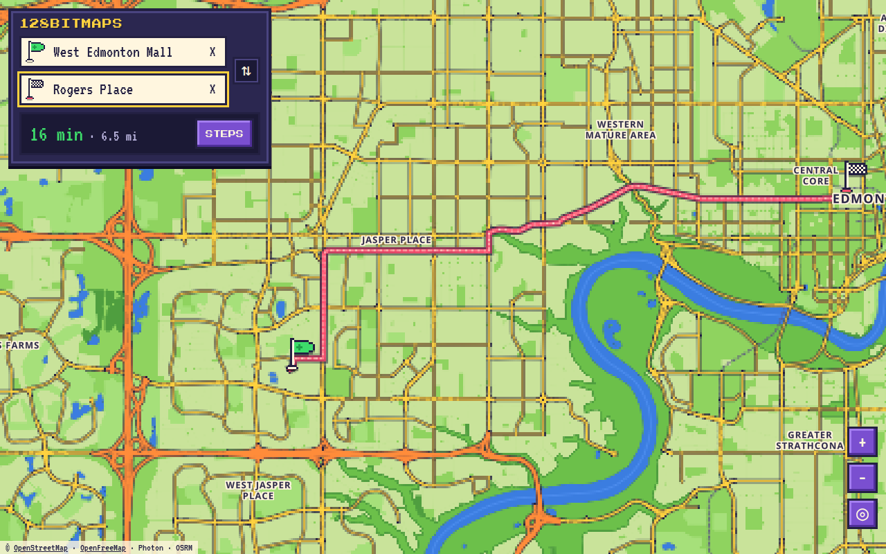

# 128BITMAPS

A from → to map app drawn in chunky retro pixel art. Real streets, real directions, 16-bit style.



## What works now (step 1)

- **Pixel-art map of the real world.** Built on OpenStreetMap data, drawn in a small retro palette at 1/3 resolution and scaled up without smoothing, so every street turns into chunky pixels. Place and street names are drawn on a separate sharp layer so they stay readable.
- **From / To search** with suggestions as you type (near where the map is looking).
- **Tap anywhere on the map** to drop a pin, then pick **FROM HERE** or **TO HERE**.
- **Use my location** in either box, plus a "find me" button.
- **Driving route** drawn as a pixel road line that pulses like an old-school game path, with marching dashes heading to the finish flag, plus trip time and distance.
- **Turn-by-turn steps**: tap one to zoom to that turn.
- Swap button, and your last trip is remembered on the device.
- Works on laptops and on phones held upright or sideways (in landscape the panel slides to a slim left column so the map stays visible).

## Roadmap

1. ~~Pixel map + From/To directions~~ ✅
2. Save your own places and pick a pixel building for each (gym → dungeon, work → prison, home → castle), starting with 10 buildings
3. Pick a pixel car and watch it drive your route
4. The full set of ~50 animated pixel buildings
5. Backup/restore, polish, put it online, then wrap it as Android and iPhone apps (Capacitor)

## Run it

```sh
npm install
npm run dev      # open the printed link
npm run build    # production build into dist/
```

## Built with

React + TypeScript + Vite, [MapLibre GL](https://maplibre.org/) for the map, free map tiles from [OpenFreeMap](https://openfreemap.org), search from [Photon](https://photon.komoot.io), and routes from the public [OSRM](https://project-osrm.org) server. Map data © OpenStreetMap contributors.

The OSRM and Photon public servers are fine for personal use. Before a big public launch, switch to a routing/search service with its own API key.
