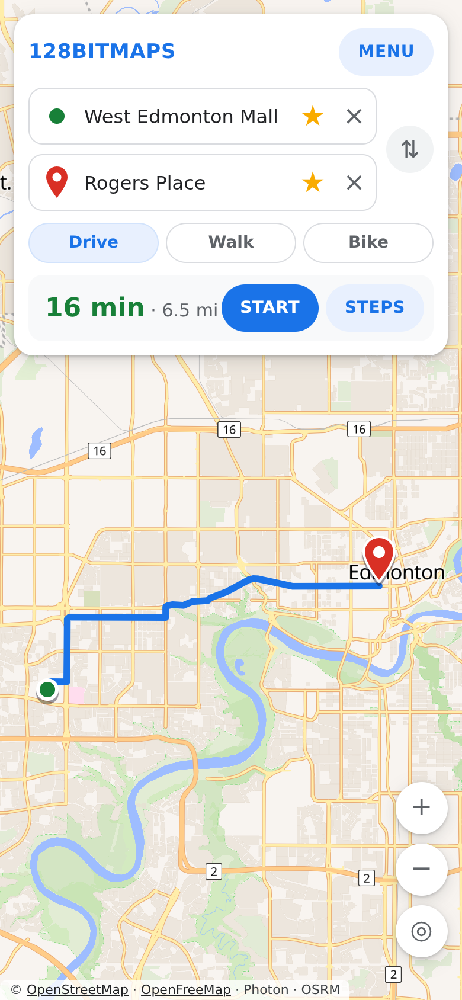
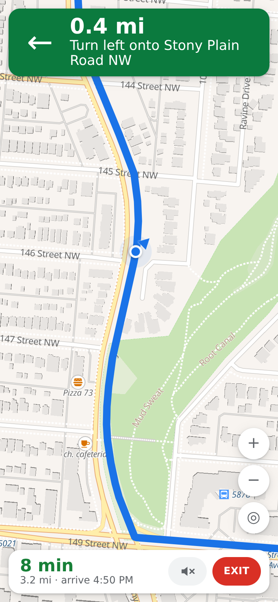
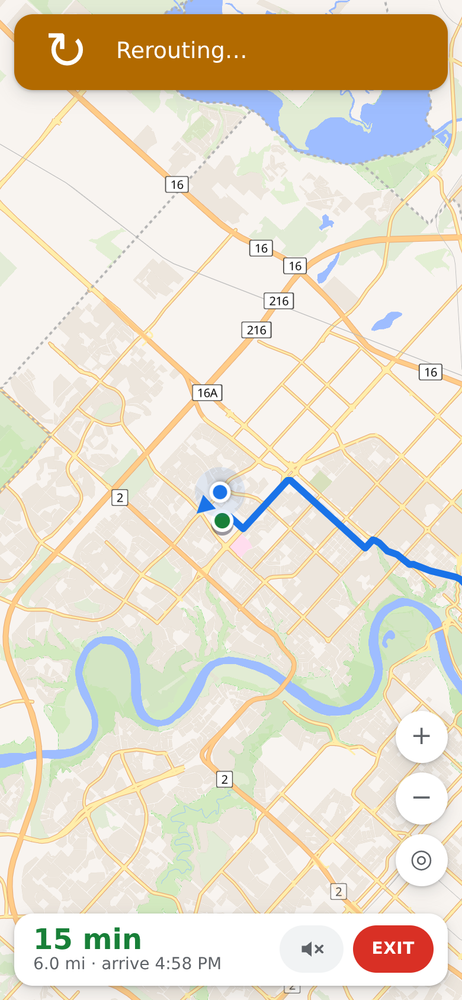
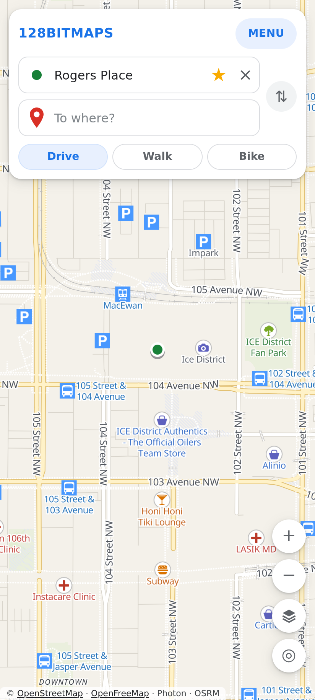
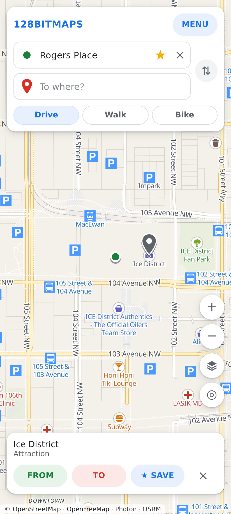
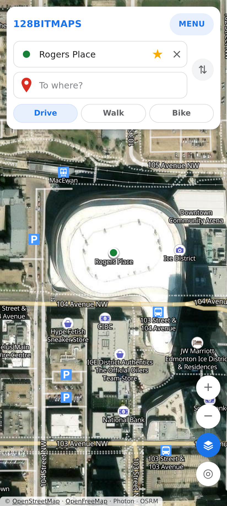

# 128BITMAPS

A maps app. Pick point A and point B and it guides you there, turn by turn, using your real position, with spoken directions.
It looks like a normal maps app by default. If you like, there is an optional **Retro** look: a pixel-art map, tiny animated buildings for your saved places, and a car you can watch drive your route.

| Choose A and B | Guided, turn by turn | Off route? It re-routes |
|---|---|---|
|  |  |  |

| Places and detail | Tap a place | Satellite |
|---|---|---|
|  |  |  |

## What it does

- **Directions from A to B.** Search as you type, tap the map to drop a pin, or use your location. Choose **Drive, Walk or Bike**. You get the time, distance and a list of steps.
- **Real guidance while you move.** Press **START** and it follows your GPS position: a big banner shows the next turn with a live countdown (the distance ticks down as you drive), a "then" preview, your speed, the time you'll arrive and how much is left.
- **A 3D driving view.** The map tilts and turns to face the way the road goes, with you near the bottom of the screen and the map zooming out as you speed up. The **2D / 3D** button flattens it. Drag the map to look around and tap **RECENTER** to snap back. In the classic look you are a blue arrow lying on the road; in the retro look you are a pixel car seen from behind, with the buildings rising up in chunky 3D.
- **Smooth, on-the-road position.** GPS only reports about once a second, so the app snaps you to the road, keeps moving you at your speed between reports, steers the camera by the road's direction (not the jittery GPS compass) and ignores wild one-off readings.
- **Voice directions in three steps.** A heads-up ("In half a mile, turn left onto 87 Avenue"), a reminder, and "Turn left onto 87 Avenue" right at the turn. The distances scale with your speed. Turn it off from the speaker button or the menu.
- **Keeps guiding with the screen off (Android app).** A background service asks the phone for its most accurate (fused, high-accuracy) GPS about once a second, keeps the voice going, and shows the next turn, distance and arrival time in an ongoing notification on the lock screen, with an **End** button. On Android 16 (Pixel) it is a "Live Update", so the next turn also appears as a chip on the lock screen and always-on display. The app can also be opened over the lock screen without unlocking. Allow location and notifications when asked.
- **PREVIEW.** Try the whole thing from your couch: a simulated drive along your route that uses the same view, countdown and voice.
- **Re-routes when you miss a turn.** If you leave the route it says "Rerouting…" and finds a new way from where you are.
- **A detailed map.** Shops, restaurants, cafes, clinics, parking, bus and train stops, parks and landmarks show up with icons and names as you zoom in, with footprints and 3D buildings up close. **Tap any place** to select it, then set it as From or To. A **satellite** button (the layers button) switches to real imagery with readable names.
- **Better address search.** Search uses two free OpenStreetMap services: Photon while you type, and Nominatim when the text looks like a street address ("10250 101 Street"), with results appearing as soon as the first answers. House numbers also show on the map when you zoom in close.
- **Find nearby.** One tap on Restaurants, Coffee, Gas, Groceries, Parking, ATMs, Pharmacy, Hotels, Bars, Shopping, Transit, Parks or Washrooms lists the nearest ones (instantly, from the map itself) and drops dots on the map. Saved places named Home or Work get their own shortcut.
- **Route options.** You get up to three routes with their time, distance and main road; tap one in the list or on the map to switch. The map falls back to a second routing server if the first is slow.
- **Night map.** MENU → LOOK → Day or night (Auto follows your phone's dark mode).
- **Open in Google Maps.** Links on the route and on any place hand the trip or place to the real Google Maps for anything this app is missing.
- **Saved places.** Tap the map (or search) and press **SAVE**, for example Home, Work or the gym. Saved places show up when you type in From or To.
- **Backup and restore** your places as a file, to move them to another phone.
- **Opens where you are** the first time, like any maps app.
- **Works on laptops and phones**, upright or sideways. Menus are a side panel, a bottom sheet or a side column so the map is always visible.
- **Installs like an app.** Add it to your home screen from the browser, or use the Android/iPhone projects below.

### Retro look (optional)

Open **MENU → LOOK → Retro** to switch. You get the pixel-art map, a pulsing route, and:

- **50 animated pixel buildings** for your saved places, on 10 shelves (the gym as a dungeon, work as a prison, home as a castle, and 47 more). A name like "Planet Fitness" or "Grandma's house" suggests a fitting one.
- **10 pixel cars**. Pick yours in the menu and it is the car you drive, seen from behind with glowing tail lights, while you navigate (or **PREVIEW**).

Everything in the retro look is drawn in code (`src/pixel/`), so there are no image files to manage. To see all of it, run `npm run dev` and open `/?sprites`.


## What it doesn't do yet

Be aware, this is a personal-scale app built on free services:

- **Search only knows OpenStreetMap.** Many businesses and some house numbers that Google has are simply not in it, so a few places will still be missing. Fixing that fully needs a paid or keyed search service.
- **No live traffic**, no lane guidance and no public transit directions.
- **Background guidance is Android-app only for now.** In a browser or on iPhone the app has to stay open with the screen on. The lock-screen notification is untested on real phones so far.
- **The black-and-white always-on map isn't possible for an app.** Android draws the always-on display itself; apps can only supply the Live Update chip.
- **Needs an internet connection** for the map, search and routes (there are no offline maps).
- Walking and cycling routes come from a free community server, and routes for a big trip can take a moment.

## Run it

```sh
npm install
npm run dev      # open the printed link
npm run build    # production build into dist/
```

## Put it online (GitHub Pages)

The workflow in `.github/workflows/pages.yml` publishes the site whenever `main` changes.

1. Merge this work into `main`.
2. In the repo: **Settings → Pages → Build and deployment → Source: GitHub Actions**.
3. Push (or run the workflow from the Actions tab). The site appears at `https://<your-user>.github.io/128bitmap/`.

On a phone, open that link and use **Add to Home Screen** for a full-screen app straight away.

## Android and iPhone apps

The web app is wrapped with [Capacitor](https://capacitorjs.com): `android/` and `ios/` are native projects that load the same code, using the phone's own location and voice.

After changing the web app, sync it into both projects:

```sh
npm run build:app
```

### Android

```sh
npm run android          # opens Android Studio; press Run to try it on a phone or emulator
cd android && ./gradlew assembleDebug    # or build an installable test file
# -> android/app/build/outputs/apk/debug/app-debug.apk
```

A ready-made test build is in [`releases/`](releases/README.md). To publish on Google Play you need a [Play Console](https://play.google.com/console) account (one-time US$25) and a signed release build (Android Studio: *Build → Generate Signed App Bundle*).

### iPhone

iPhone apps can only be built on a Mac with Xcode.

```sh
npm run ios              # opens Xcode; pick your iPhone and press Run
```

To publish on the App Store you need an [Apple Developer](https://developer.apple.com/programs/) account (US$99 a year). Apple reviews every app before it goes live. If you don't have a Mac, a cloud build service (for example Ionic Appflow or Codemagic) can build the iPhone app for you.

### Before you publish

- **App ID.** `app.bitmaps128.map` in `capacitor.config.ts` is the app's permanent store ID. Change it before the first release; it can't change afterwards.
- **Search and routes.** The free public Photon (search) and FOSSGIS OSRM (routes) servers are fine for personal use. For a public launch, switch to a routing/search service with its own API key (see `src/lib/geo.ts`).
- **Map tiles.** OpenFreeMap is free and needs no key. Keep the OpenStreetMap credit visible.

## Why it loads fast

The map style, its icons and the common Latin fonts ship inside the app (`public/map`, `src/map/classicStyle.json`), so the map doesn't wait on a chain of requests before it can draw; only the map tiles come from the internet. On phones the map is drawn at up to 2x (not 3x) resolution to stay smooth, and 3D buildings only appear when you're zoomed in close. The style is generated by `python3 scripts/make-classic-style.py`, which is where to change colours or how early places appear.

## How guidance works

`src/nav/Navigator.ts` takes each GPS fix, snaps it to the route near where you last were, and then runs a frame loop that glides the car along the road at your speed, steers a tilted camera, counts the distance down and speaks each turn in three steps. It asks for a new route after a few positions away from the road. `src/nav/geometry.ts` holds the maths. Tests fed a fake GPS track along a real route (also with noisy and wildly wrong readings), including driving off it, and checked the banner, the live countdown, the camera tilt and smoothness, arrival and re-routing. What they cannot check is how real GPS on a real road behaves, so please try it in a car and tell me what feels off.

## Built with

React + TypeScript + Vite, [MapLibre GL](https://maplibre.org/) for the map, free map data from [OpenFreeMap](https://openfreemap.org), satellite imagery from Esri (attribution shown; check their terms before a public launch), search from [Photon](https://photon.komoot.io), routes from the [FOSSGIS](https://routing.openstreetmap.de) OSRM servers, and [Capacitor](https://capacitorjs.com) for the phone apps. Fonts for the retro look: Press Start 2P and VT323 (SIL Open Font License), bundled. Map data © OpenStreetMap contributors.

## Roadmap

1. ~~Map with directions from A to B~~
2. ~~Real turn-by-turn guidance, voice and re-routing~~
3. ~~Saved places, Drive/Walk/Bike, backup~~
4. ~~Optional retro look with buildings and cars~~
5. ~~Installable app, Android and iPhone projects~~
6. Next: iPhone background guidance and Live Activities (needs a Mac), live traffic, offline maps, sync places between devices, share a place with a friend
